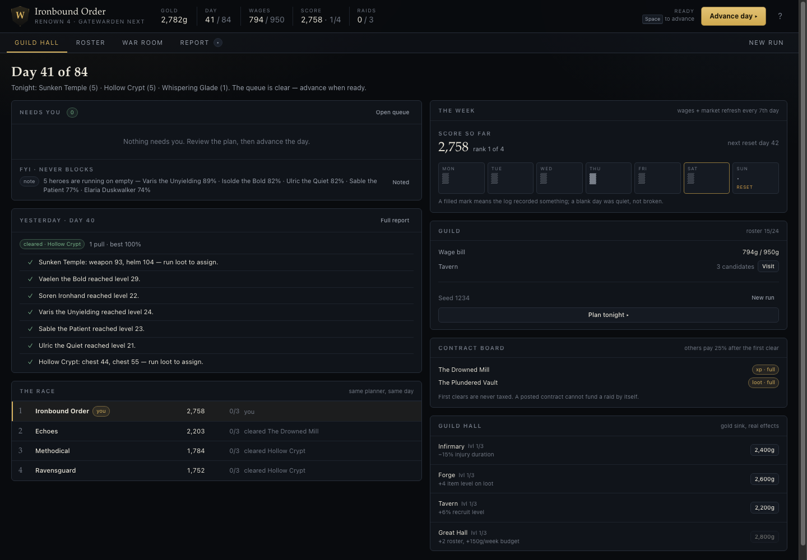
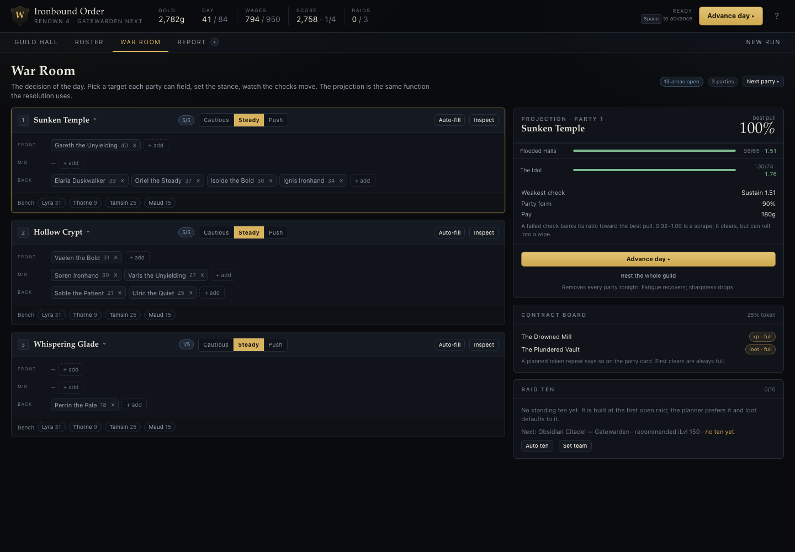
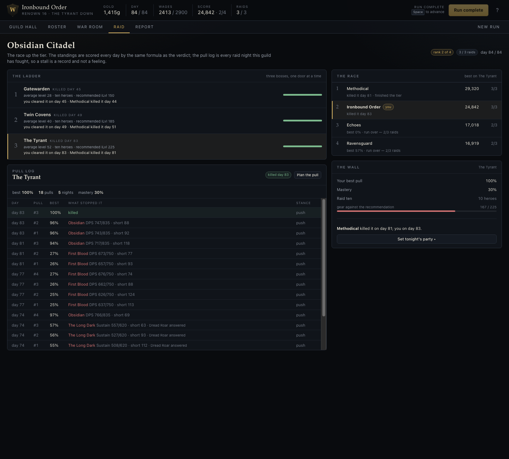

# Screens — the specification

Every screen below is specified as: **purpose → regions → data/Lists → actions → modals → edge states → mobile**. The architecture follows the FM26 six-hub model ([fm-blueprint.md](fm-blueprint.md) §1.3) because it is the right size for us.

> **Build status (2026-10-31).** The vertical slice ships, plus the surfaces the loop needs: the attention queue, the tavern, the facilities and the raid hub. The screenshots below come from seed 1234 and seed 7: a day-41 state, the day-84 verdict and the finished run, all produced by the AI planner and loaded into the browser.
>
> | Screen | State | Where it differs from this spec |
> |---|---|---|
> | Global chrome | Built | Gold, day, wages, score, rank, raids; labelled tab badges (the count hides on the open tab); Space to advance; `1–5`, `R`, `W`, `Esc`. The advance button is sticky, not fixed to the bottom on mobile. |
> | Guild Hall | Built, compact | Queue-first layout, digest, standings with a link to the raid hub, week strip, contract board, promises, loot, facilities, tavern. The week strip reads the event log, so a routine farm night with no events is blank. |
> | Roster | Built | Table, six views, class filter, search, sort, group-by-class, status chips, last five events, a role portrait in the name cell. An alerts strip names the expiring contracts and injuries behind the tab count and opens the hero sheet. No bulk selection, column chooser, compare mode or power trend (there is no 7-day history in the sim). |
> | Hero Sheet | Built | Attributes, all eight role chips with fit multipliers, previewed check contributions, gear, condition, contract, traits, ten-day event strip. Potential is shown as unscouted, not scouted; the portrait is the hero's natural-role image, not the assigned role; no compare drawer. |
> | Tavern | Built, reduced | Candidate list with role portraits and immediate signing at the listed fee. No scouting fog, no watchlist, and no three-round wage negotiation: the sim's `hireCandidate` has no negotiation state. |
> | War Room | Built | Click-to-fill slots in Front/Mid/Back order, target picker, inspect sheet, live projection, stance, auto-fill, standing raid ten, loot strip, rest day. Each party card prints its average level against the area gate and carries a thumbnail of its target; the target picker shows a 44×26 still for every area and Inspect opens the area sheet with a 16:9 key-art banner and the drop table with item icons; the hero picker repeats the requirement and labels `lvl · iLvl · pow`. No drag-and-drop, no flasks (no prep purchase exists in the sim), no split-run funnel. |
> | Report | Built | Digest, killing/failed pull, per-phase checks, threat counter, traits, injuries, drops, next levers, live score breakdown. It is a **screen**, not a modal: a report the player can leave and come back to survives reload; a modal does not. The fight card opens with a 96 px banner of the area. |
> | Raid hub | Built, reduced | The three-boss ladder with lock reasons, the four-guild race with live activity, the best pull on the selected boss for every guild, and a per-pull log of the guild's raid nights. The boss map is a vertical list, not a spatial map; the analysis link opens the Report screen; rivals carry no pull log of their own. |
> | Run End | Built | Rank, band, score, component bars, three moments generated from the data, the four-guild table, same-seed and new-seed buttons. It is a card on the Report screen, not a full-screen takeover. |
> | Guild / finances | Partial | Wage bill, roster cap, promises and the four facility upgrades are on the Hall. No contracts table and no settings modal. |
> | Mobile | Responsive | One column, stacked top bar, horizontally scrollable table and week strip; the pull log drops the stance column. The roster becomes a scrolling table rather than the specified card list; Advance is in the sticky header, not a fixed bottom bar. The nav hides its optional "New run" tab and shortens Guild Hall / War Room to Hall / War below 560px. |
>
> **Screens pulled forward, and why.** The slice spec stops at Roster, War Room and Report. A run that cannot hire is stuck at three heroes: the first dungeon needs four and the first raid needs ten, and the first dungeon is also the first free recruit. The tavern is therefore part of "playable", not amplification. Facilities came with it because the AI's surplus gold had a sink and the player's did not. The raid hub came after the slice because standings alone answer "who is winning"; the hub answers "who killed which boss, on which day, and how long have we been stuck".
>
> **Deliberately not built:** drag-and-drop, bulk roster actions, comparison drawer, column chooser, scouting fog, wage negotiation, split runs, flasks, board objectives, settings. Each needs either a sim field or a real playtest first.
>
> Screenshots: [Guild Hall](screenshots/hall.png) · [Roster](screenshots/roster.png) · [Hero Sheet](screenshots/hero-sheet.png) · [War Room](screenshots/war-room.png) · [Raid hub](screenshots/raid-hub.png) · [Report](screenshots/report.png) · [Run End](screenshots/run-end.png).
>
> 
>
> 
>
> 

---

## Visual direction (O2, resolved 2026-10-31)

Dark operations console, not a fantasy illustration. The game is read at a glance, for thousands of numbers, so the surface is dark slate with one gold accent and four semantic colours.

| Token | Value | Use |
|---|---|---|
| Background | `#090b0e` | Page |
| Panel | `#10141a` / `#151a22` | Cards, rows |
| Line | `#272e39` | Dividers and panel edges |
| Ink | `#e9e5d9` | Primary text, warm rather than white |
| Muted / dim | `#9aa1ac` / `#727985` | Labels, secondary facts |
| Gold | `#d8b35f` | The one accent: primary action, selection, score |
| Good / warn / bad / info | `#7cb98d` / `#d6a24a` / `#d07272` / `#82a8d0` | Check verdicts and status |

- **Type:** Palatino-family serif for screen titles, the score and the band; system sans at 11–13px for tables and controls. All numbers use tabular figures.
- **Density:** 6px table cell padding, 4–6px radii, one border weight. Rows are the unit; panels are quiet containers.
- **Spacing:** a 20px page gutter, 14px between panels, 6–8px inside lists.
- **Rejected:** parchment and light theme (eight attributes and twenty rows become a wall of beige); pure-black terminal (panels disappear and the eye cannot group); blue SaaS dashboard (reads as a tool, not a race); a component library (the dense table is the product and every library fights it).
- **Images:** 98 files, all wired. Role portraits in the roster, hero sheet and tavern; location art in the war room target picker, party cards, raid hub and the report banner; item art in the market and every loot row. One `Art` component resolves the extension (`.jpg`, `.jpeg`, `.png`, `.webp`) and caches the answer per path; a missing file is a grey placeholder, not a broken screen. Portraits key on `naturalRole` (never changes) and not `role` (the planner reassigns it per fight). Item art keys on the drop's name, kebab-cased by the same rule that names the files. The generation brief is [art-prompts.md](art-prompts.md).
- **Still placeholders:** no crest art beyond a letterform, no 2D battle view.

---

**Global chrome (every screen)**

```
┌──────────────────────────────────────────────────────────────────────────────┐
│ 🛡 Ironbound Order · Renown 3   │ 1,240g │ Day 12/84 │ ⚠ Wage 612/445 │ [ADVANCE DAY ▸] │
├──────────────────────────────────────────────────────────────────────────────┤
│ GUILD HALL ① │ ROSTER │ TAVERN │ WAR ROOM │ RAID │ GUILD                 │
└──────────────────────────────────────────────────────────────────────────────┘
```

- Crest → Guild screen. Renown → tooltip explaining what it gates.
- Gold, Day, Wage always visible: the three resources that matter.
- A red count on a tab = what waits inside that screen. The count hides on the tab currently open, because its panel is already on screen; the tooltip and accessible name name the thing (`1 item needs you before Advance`, `2 contracts expiring, 1 injury`, `no party planned for tonight`). A soft dot on Report = a day report you have not opened yet.
- **ADVANCE DAY** is persistent, right-aligned, and shows a live sub-label: `2 items need you` when blocked. Keyboard: `Space`.
- Global shortcuts: `1–6` tabs, `R` roster, `W` war room, `Space` advance, `Esc` close drawer.

---

## 1. Guild Hall (home)

**Purpose:** answer "what is happening, what needs me, how is the race" in under five seconds. This is FM26's Portal, and it is the screen the player will see 80% of the time.

> **Design correction (from the research, and it reverses my first instinct).** FM originally had a *separate* Home dashboard and Inbox. SI's telemetry showed nobody used the dashboard, so FM26 **merged the two into Portal** — one surface where messages and attention come first. `research/fm-01` §11 lists "separate Home + Inbox" as a mistake not to repeat.
>
> So the Guild Hall is **not a dashboard with a queue bolted on**. It is an **obligations-first surface**: the attention queue is the spine and dominates the top-left; the digest, ticker and calendar are subordinate panels that can be collapsed. If a player ever reads the ticker before reading what needs them, the hierarchy is wrong. Concretely: the queue occupies the primary column at every breakpoint, and the rest of the page is *below* it on mobile.

**Regions**

```
┌───────────────────────────┬───────────────────────────────────────────────┐
│ NEEDS YOU (2)             │  YESTERDAY                                     │
│ ⚠ Thorne: contract 3 days │  Raid · Boss 3 · 9 pulls · best 41%  [open]   │
│   [Renew] [Counter] [Walk]│   ├ P3 enrage failed: 412 vs 470                 │
│ ⚠ Wage bill over budget   │   └ Ignis top damage · Thorne off-role          │
│   [Cut] [Raise income]    │  Dungeon · Halls of Valor · cleared · +2 items │
│                           │  Farm · 4 heroes · +180g                       │
│ FYI (4) ▸                 │  [full report]                                 │
├───────────────────────────┼───────────────────────────────────────────────┤
│ WORLD FIRST               │  THE WEEK                                      │
│ 1 Echoes      2/3 · 62%   │  Mon Tue Wed THU Fri Sat Sun                   │
│ 2 YOU         2/3 · 41%   │  ▓▓  ▓▓  ░   ▓▓  ▓▓  ░  ★RESET                │
│ 3 Methodical  2/3 · 28%   │  ▓ raid  ░ farm  ★ wages + tavern refresh      │
│ 4 Ravensguard 1/3         │  [plan tomorrow →]                             │
└───────────────────────────┴───────────────────────────────────────────────┘
```

- **Needs You** — max 3 blocking cards, each with inline buttons. Cards *are* the attention items ([guild-manager-model.md](guild-manager-model.md) §7). Clicking opens the modal; the inline buttons resolve directly.
- **FYI** — collapsed one-liner feed, expandable. Never blocks.
- **Yesterday** — the digest, compressed to one line per activity, with a link to the full Day Report modal.
- **Loot FYI** — one non-blocking line while drops wait: `2 drops — Ashbringer (weapon 232) → Varis +84 · Assign`. It never counts toward the three blocking cards and never gates Advance; the next Advance auto-assigns.
- **World First** — top 4 guilds, boss count, best pull %, with your row highlighted. Click → Raid screen.
- **Score so far** — a small strip under the ticker: `Score 8,450 · rank 2 of 4`. The score must be visible early and often, or the deadline feels arbitrary. No breakdown here; the breakdown lives on the Raid screen and at the Run End.
- **The Week** — 7 day-cells: activity density (▓ raided / ░ farmed / blank rested), plus the RESET marker on day 7. This is the "one glance" answer to "when do I get paid / when does the tavern refresh".
- **Today's star** — one open non-raid area pays +50% gold. The panel names the area, its base gold and XP, and whether it is already cleared. The same area carries a ★ in the target list and on the party card, so the player meets it in the place where the decision is made.
- **Market** — a second gold sink beside the facilities: gear at the guild's tier, salves for injury days, rations for fatigue, and a three-day tonic. The panel prints the current gear tier and opens the market modal.
- **Contract board** — one line: `Contracts: The Wolf Den (XP) · The Toll House (gold) — full pay. Others 25% after the first clear.` It sits under the score strip, because it changes what tonight is worth.

**Empty state (day 0):** replaced by a single card — *"Set your first raid. 10 heroes, one dungeon, and 6 days until Echoes arrives."* → War Room.

**Mobile:** Needs You first (full width), then World First, then Yesterday collapsed; the Week becomes a horizontal scroll strip.

---

## 2. Roster

**Purpose:** the master table. Scan the guild, sort by anything, select heroes for action, open the inspector.

**Layout:** full-width table + a right drawer (Hero Sheet) that opens on row click without leaving the list.

**Columns (default 9, all optional via column chooser):**

| Column | Render |
|---|---|
| Hero | class icon + name + status chips (⚑ unhappy, ✚ injured, ⏳ expiring) |
| Class / Role | "Mage · Evoker" with role-fit badge colour |
| Lvl | number |
| Power | number + trend arrow (Δ vs 7 days ago); hover shows the form multiplier |
| Potential | ★★★☆☆ — **hidden** (█ grey) until scouted/known |
| iLvl | average gear level |
| Fatigue | bar (green→amber→red) |
| Sharpness | bar (rust→sharp); the second clock, and why a rested hero hits softer |
| Morale | 5-level icon + % |
| Wage | g/week, red if above budget share |
| Contract | days left, red < 7 |
| Last 5 | ✓✓✗—✓ activity strip |

**Views (saved filters):** `All · Raid-ready · Resting · Unhappy · Expiring · Injured`

**Alerts strip.** When a contract is inside seven days or a hero is injured, a strip above the table names each one — `Contract · Perrin the Pale · 7 days left · 124g/week` — and opens the hero sheet on click. It counts the same expiring-plus-injured set as the Roster tab badge and the Injured view: the badge says how many, the strip says which hero and why. The strip shows the five most urgent; the rest are one `+N more` line pointing at the Expiring / Injured views.

**Filters:** class, level range, role fit, wage max, status. Attribute-range filter available via "Advanced" (FM-style query) but not in the MVP default surface.

**Sorting:** click header; multi-sort with shift.

**Grouping:** collapsible bands by class (Warrior / Cleric / Mage / Rogue) — this is the depth-chart view, and it's the default grouping.

**Bulk selection:** checkbox column → sticky action bar: `Raise · Rest · Assign to Raid/Dungeon/Farm · Dismiss`.

**Edge states:** an empty roster (shouldn't happen) → "Visit the Tavern"; a hero with 0% health → row desaturated with an `OUT 3d` chip.

**Mobile:** card list, 3 lines per hero: `name · class · lvl` / `power · iLvl` / condition+morale bars. Same drawer on tap.

---

## 3. Hero Sheet (drawer, not a page)

**Purpose:** everything about one hero, without losing the list. 480px wide, slides from the right, `Esc` closes.

**Blocks (top → bottom):**

1. **Identity** — portrait, name, level, class, current role, **Power 127** (large) and the four check contributions for the selected role, status chips, and up to three trait chips (`Keen Eye`, `Steadfast`).
2. **Attributes** — 2 columns × 4 rows (**Body** | **Spirit**), colour-banded 1–20. No scrolling, no tabs. Every value has a tooltip; candidates show ranges (`12–16`) instead of numbers.
3. **Role fit** — a row of 8 chips; each shows `Evoker 127 · DPS ×1.15`. The selected one is highlighted, and the row below shows the four check contributions (`DPS 38 · Mit 52 · Mech 78 · Sus 46`) with the before → after delta. The chips use `checkPowerInRole`, not the role-blind power; clicking previews the check change live before you commit. The familiar `powerInRole` number stays beside the class line.
4. **Gear** — 4 slots with iLvl + rarity colour. There is no bag; a clear's drops wait in the loot queue and the Day Report lists them with the deltas, and the Hall and War Room strips reopen the same rows.
5. **Condition** — fatigue bar, sharpness bar, health bar, morale icon, and a sentence: *"Output at 93%: condition and sharpness are both in the numbers. Two more raid nights before fatigue bites."*
6. **Contract** — wage, days left, release clause, squad-status promise, market value. `Renew` / `Release` buttons.
7. **History** — 10-day activity strip, bosses seen, kills, wipes, drops received.

**Actions footer:** `Assign…` · `Rest` · `Renew contract` · `Release` · `Compare…`

**Compare mode:** opens a second drawer (stacked or side-by-side) with a delta column — used for "who gets the drop".

---

## 4. Tavern

**Purpose:** recruitment, and the only place uncertainty is *fun*. Two regions: candidate list (left, ~60%) and the selected candidate's rumour card (right).

```
┌──────────────────────────────────────┬────────────────────────────────────┐
│ FILTERS: class ▾  level ▾  wage ▾    │  Vaelen · Rogue · Lvl 62           │
│ ─────────────────────────────────    │  Rumoured abilities                 │
│ ★ Vaelen   Rogue   62   200g  ★★★★☆ │  Agility      14–17                 │
│ ★ Lyra     Mage    48   120g  ★★★☆☆ │  Focus        14–17                 │
│ ★ Brother Ansel Cleric 55 90g ★★☆☆☆ │  Awareness    11–14                 │
│ ─────────────────────────────────    │  Discipline   08–12  ⚠ low          │
│ 3 candidates · refresh in 4 days     │  Potential    ★★★★☆                 │
│                                      │  "Rumoured to sulk when benched."   │
│                                      │  Wage demand 200g · Fee 1,100g      │
│                                      │  [Sign…]  [Watchlist]               │
└──────────────────────────────────────┴────────────────────────────────────┘
```

- **Fog:** ranges, not values. Range width = `f(renown, days on board, facility level)`. A `⚠ low` annotation appears only when the range is narrow enough to be sure it's bad — otherwise no hints.
- **Sorting:** by potential stars, by wage, by role fit to your current party gaps.
- **"Gaps" nudge:** the list highlights candidates who fill a role your roster lacks (`your raid has no Oracle`).
- **Refresh:** 3 new candidates every day-7 reset; refresh button costs gold (150g) and can be used once per day.

**Signing modal** (the FM contract negotiation, reduced to three knobs):
```
SIGN VAELEN
Wage offer       ▾ 180g  190g  200g  (demand: 200g)
Contract length  ▾ 1 season  2  3
Squad status     ▾ A-team  Rotation  Bench     ← this is the promise
                                                  (A-team: +10 morale now, −25 if broken)
Terminal value:  +6 power to your raid  −145g/week
[Offer]           agent patience: ●●●
```
- 3 negotiation rounds. Lowballing twice → candidate walks (and the market shows "lost: Vaelen").
- **Squad-status promise is the drama engine.** It has no mechanical effect on power; it has a large effect on morale when violated. Exactly like FM.

**Edge states:** can't afford → Offer button disabled with `need 1,100g`; roster full → `guild hall full (22/22)`.

**Mobile:** list only; tapping opens the rumour card full-screen with a sticky Sign bar.

---

## 5. War Room

**Purpose:** the single decision screen of the day. Everything the player *does* happens here.

```
┌──────────────────────────────────────────────────────────────────────────────────┐
│ RAID PARTY  (10/10)   Squad Rating 812   Stance: [Steady ▾]  Flasks: 2      │
│ ┌───────────────┬───────────────┬───────────────┐                                │
│ │ FRONT         │ MID           │ BACK          │   Target: Boss 3 Archdemon Vael│
│ │ Oros   Bulwark│ Varis Assassin│ Ignis Evoker  │   Recommended iLvl 170         │
│ │ Gareth Bulwark│ Thorne Trickster│ Lyra Arcanist│   Your avg iLvl 158 ⚠          │
│ │ [empty]       │ Ansel Oracle  │ Elaria Light… │   Mastery +18% (12 pulls)      │
│ └───────────────┴───────────────┴───────────────┘   Est. best pull: ~48%        │
│  Bench: Bram · Sable · Corin · Wren · Ottilie · +2                               │
├──────────────────────────────────────────────────────────────────────────────────┤
│ DUNGEON PARTY (5/5)  Halls of Valor   [Auto-fill: lowest fatigue ▾]              │
│ FARM PARTY (4)       Emberwood  ▾   ○ Split-run → funnel gear to: [Ignis ▾]     │
├──────────────────────────────────────────────────────────────────────────────────┤
│ PROJECTED: checks vs Boss 3   P1 Mechanics 1.06 ✓  P2 Sustain 0.98 ~  P3 DPS 0.84 ✗│
│                            [ ADVANCE DAY ▸ ]                                      │
└──────────────────────────────────────────────────────────────────────────────────┘
```

This screen is the whole game, so its details matter:

- **Slot layout is spatial**, not a list (FM's tactics screen lesson). Three rows: Front / Mid / Back. Drag from the bench pool, or click a slot and pick.
- **An illegal party is a visible state, not a dead end.** The card always lets the player edit: `×` removes a hero (leaving `2/3`, or `0/3` when the last one goes), and `+ add` or a bench chip still adds above the cap (`4/3`). Either side of the range turns the size chip red, prints `Below the hero minimum — 0/3. Add 3 before the day can advance.` (or `Above the hero limit — 4/3. Remove 1…`) under the slots, and blocks Advance (store guard, top bar `1 party outside the hero range`, War Room tab badge). An empty party keeps its target: the slots and bench stay on the card, so the player refills it there instead of losing the target. `Remove this party` is the separate way to drop the target. A fixed-size area (The Wolf Den, The Warrens: 3) is re-lined either way: remove the outgoing hero then add the incoming one, or add first and remove after. `Auto-fill` produces a legal party in one click.
- **Fatigue is visible where it is decided.** Every assigned hero carries a pill after `lvl`: `Tired 52` (amber) from 45 fatigue, `Exhausted 91` (red) from 70. The card head counts them (`1 exhausted`), bench chips carry the same pill, and the add picker prints `1 exhausted hero in this list` and repeats the pill on that hero's row; the raid-ten picker uses it too. The pill, the Roster status chip and the raid-ready filter read one `fatigueState`; the lines are `FATIGUE_LINES` in `tuning.ts`.
- **Level gate.** Every party card prints `avg lvl 12.3 / 1` beside its size, red when the party average is under the area's requirement. The hero picker repeats `needs avg lvl N · party avg X` and warns when the current party is below the line; a deployed hero prints `lvl 16` rather than a bare number, and the picker row labels `lvl · iLvl · pow`.
- **Live projection.** The bottom strip recalculates on every change: each phase's check ratio, pass/marginal/fail, colour-coded. This is the single most important interaction in the product — it lets the player *experiment* and learn the model without reading documentation.
- **"Est. best pull: ~48%"** — one number that answers "is tonight worth it?".
- **Auto-fill** buttons for dungeon/farm (lowest fatigue, best role fit) so the daily routine isn't tedious, while the raid party stays manual.
- **Split-run toggle** on the farm party with a "funnel gear to X" target. This is design, not built; the shipped funnel is the standing ten plus the loot default.
- **Flasks** as a small chip row: `2 flasks · +4% each · 120g` — one click to apply, with the gold cost shown, because "preparation is the game" needs at least one prep purchase. The shipped version of this idea is the market's tonic: +10% checks for three days, paid in gold.

**Raid team strip.** Ten chips above the raid slot: `★ name · role · lvl · iLvl`. `Set team` opens a picker; `Auto` fills the best ten; `Clear` empties it. A short team says `7/10 — the planner will fill 3 from the bench`. The team is the standing ten, not tonight's party: injuries and a failed level gate are filled for one night and the team is unchanged. A clearly stronger bench hero does not replace an available member; promotion is this strip.

**Loot strip.** After a clear, the Day Report opens with a `Drops waiting` panel: one row per drop with the suggested hero and the top three alternatives (`current → new (+gain)`), plus `Sell`, `Forge +6` and `Discard`, and an `Auto — need pick` button. Anything left takes the default on the next Advance, and no drop is ever a blocking item. No modal opens over the report: loot belongs to the day it came from (L120). The War Room and the Hall keep a non-blocking strip that opens the same rows in the Gear Assign modal, for the player who comes back to a drop they left.

**Content picker (the target list).** The dropdown behind each party slot lists **only what the guild can field** — prerequisite cleared, enough heroes, average level met. Tabs above the table split `All · Farm · Mission · Dungeon · Raid` with counts; the starred area carries a ★ in its row and a chip in the tab bar. Columns: `name · kind · level · party · gold · xp · loot · pay · projected · status`. Pay is `full` for a posted contract or a first clear, `25%` for a token repeat, `—` for farms, dungeons and raids. Status is `new` (never attempted), `open` (attempted, not cleared) or `cleared ×N`. Locked and not-yet-fieldable areas are not selectable; the footer counts them and **names the next door** with its gate (`4 areas not open yet. Next door: Ashen Spire — avg lvl 33.8 / 35 over your best 5 — 1.2 short.`). The door is the first area in ladder order the roster cannot field, prerequisites ignored; it is the only closed area the screens may name (L108). Opening one fires a single digest line: `New area open: The Old Quarry — Farm, level 5, 1-5 heroes.` The list must never show a row the party command would refuse: the projected column is the best legal party's best pull, the same number the War Room strip shows.

**Next door panel.** The side column carries one more panel under the contract board: `NEXT DOOR`, the closed count, the area's name, `Dungeon · 4–5 heroes`, and the gate in the rule's own numbers (`avg lvl 33.8 / 35 over your best 5 — 1.2 short`, red; or `roster 9 / 10 heroes`). It is not a button: the area stays out of the picker until the guild can field it. The same name and gap drive the brand line in the top bar (`Renown 7 · Ashen Spire next`) and the picker footer, so the three cannot disagree. The raid-ten panel says `Next: Obsidian Citadel — Gatewarden · locked — Clear Ashen Spire first.` instead of its gear gap while the raid is behind an uncleared dungeon; the gear gap is not the blocker, and printing it reads as one.

**Clearing a target.** A party *is* a target plus its heroes. Emptying the party is an edit, not a removal: the last hero can leave, the card stays at `0/3` (red, Advance blocked) and the bench refills it. Clearing the target means removing the party. Each party card ends its head with `Remove` (two-step: `Remove` → `Confirm: remove`), and the target picker repeats it in the footer, because that is where a player who wants to clear the target looks. Removing a party frees its heroes back to the bench, leaves the other parties alone, and moves the projection selection with the card. `Rest the whole guild` under the projection stays the all-parties action; it is not the way to drop one target.

**Contract board (the daily price).** A strip above the party slots names the two posted missions: `CONTRACTS: The Wolf Den (XP) · The Toll House (gold) — full pay. Others 25%.` A planned party on an unposted repeat shows `not posted — pays 25%` in amber, with the posted alternative in the same line. The board is the reason to read the picker before the party: a target that was right yesterday can be a token night today. First clears are always full, so a new area is never punished.

**Inspect (the area sheet).** Selecting an area opens a read-only sheet before the party is committed:

- **Header** — name, kind, level, party size, recommended iLvl, status.
- **Rewards** — gold, XP per hero, item count and iLvl band.
- **Phases** — name, check, requirement, share, threat and its penalty.
- **Bestiary** — mob, role, the check it pressures, one line of what it does.
- **Drops** — named item, slot, iLvl, chance per clear. `chance` is exact: at most one named item drops per clear and it replaces one guaranteed item.
- **Your party tonight** — the best legal party from the roster and the per-phase projection, or "not enough heroes ready: N fit, needs M".

This is the screen that answers "what is in there, and is it worth tonight?" without a wiki.

**Edge states:** fewer than 8 in raid party → warning chip `undersized: −8% checks`; no boss selected → disabled Advance with `select a target`; a hero with 0 health in a slot → red slot, `cannot deploy`; an injured hero drops out of the "your party" projection, because the game will not send him.

**Mobile:** the slot layout becomes three horizontal scroll rows; projection strip stays pinned; Advance Day is a fixed bottom bar.

---

## 6. Raid (the RWF hub)

**Purpose:** the scoreboard and the story. This is where the player feels the race.

```
┌────────────────────────────────────────────────────────────────────────────────┐
│ THE OBSIDIAN CITADEL · TIER 1 · DAY 12/84                                      │
│ 1  Echoes       1/3  The Tyrant at 62%  ████████░░  "8 pulls on the Tyrant"    │
│ 2  YOU          1/3  Twin Covens at 41% ██████░░░░                            │
│ 3  Methodical   1/3  Twin Covens at 28% █████░░░░░  "farming"                 │
│ 4  Ravensguard  0/3  Gatewarden killed                                        │
├───────────────────────────────┬────────────────────────────────────────────────┤
│ RAID MAP                      │  PULL LOG — Twin Covens                        │
│ ① Gatewarden ✓ killed day 45  │  #14  41%  P3 enrage 412/470  ✗                 │
│ ② Twin Covens ◀ 41%           │  #13  41%  P3 enrage 405/470  ✗                 │
│ ③ The Tyrant 🔒 (kill ②)      │  #12  38%  P2 sustain 0.96 ~                    │
│                               │  #11  41%  P3 enrage 390/470  ✗                 │
│                               │  [analysis]                                     │
└───────────────────────────────┴────────────────────────────────────────────────┘
```

- **Leaderboard** always includes the rivals' *current activity*, not just their score — this is what makes the race feel alive. (FM's league table is static between matches; ours updates daily.)
- **Boss map** shows the ladder with lock states — the "path ahead" is always visible (progression psychology).
- **Pull log** per boss: every pull, its best %, and the failed check. This is the historical record that lets a player say "we've been stuck at 41% for four days".
- **Analysis** opens the Wipe Report modal with the "next lever" block.

> **Built 2026-10-31, reduced.** The map is a vertical ladder with the lock reason printed on each row; the race table adds each guild's kill day or best pull on the selected boss, on a second line so both fit; the pull log reads `GameState.raidLog` (the last 40 raid nights, one row per pull, with the failed check's shortfall and stance). The analysis link opens the Report screen rather than a modal, because the report is the thing that survives a reload. Rivals are summarised by `Rival.activity` and their progress rows; they carry no pull log, which keeps the log at 4 kB for 17 nights (1.5% of a 255 kB save). The first draft printed `best rival Ravensguard 100%` for a boss they had already killed, and a rounded `0.92` next to a failed pull at `688/750`; both now read as a kill day and a shortfall. See [learnings.md](learnings.md) L96–L98.

---

## 7. Guilds

**Purpose:** read the other rosters and sign one away.

The screen lists the three rivals as cards: name, rank, score, raids, roster size, the personality's one-line blurb and the live `activity` line. Selecting a card opens its roster: hero, class, role, level, iLvl, power, wage and a `Poach <fee>g` button. A hero already in the rival's plan or raid ten is tagged, and says so in the confirmation panel before the fee is spent. The panel repeats the fee, the wage, the role and the roster cap; `Sign` is the only commit.

**Rules the screen prints:** fee = the tavern's price for his level × 1.5; wage = the market rate × 1.25; the contract is 28 days at rotation status. The hero leaves the rival's roster, plan and raid ten in the same action. Rivals sign each other's bench at 6% a day; the report logs `Ravensguard signed X (lvl 24) from Echoes.` A poach by the player is answered by one rival-offer card inside ten days, and the screen says so. The roster cap, arrears and the purse are the same gates the tavern uses, and a blocked button prints the reason.

---

## 7.1 Guild (Hall card)

**Purpose:** the budget, the contracts, and the facility stub. Deliberately thin in MVP.

- **Finances card:** gold, weekly income estimate, wage bill vs budget, projected 7-day balance, and a red flag if the wage bill exceeds budget.
- **Contracts table:** hero, wage, expiry, status promise, `Renew` action. Sorted by expiry.
- **Facilities (stub in MVP):** 4 cards — Infirmary (recovery), Forge (gear quality), Tavern (recruitment quality), Hall (roster cap) — each with level 1–3 and an upgrade button. Even a stub is important: it's the gold sink that makes the late game feel like progress.

---

## 8. Run End (day 84) — the ranking screen

**Purpose:** close the loop with a verdict and a story, then get the player into another run. Full-screen takeover, not a modal — this is the game's ending and it should feel like one.

```
┌──────────────────────────────────────────────────────────────────────────────┐
│                    THE OBSIDIAN CITADEL — RUN COMPLETE                       │
│                                                                              │
│                         RANK 2 of 4        BAND  A                          │
│                             22,690                                          │
│                                                                              │
│  Raids      18,000  ████████████████████████  all three down                 │
│  Dungeons      800  ███░░░░░░░░░░░░░░░░░░░░░  4 cleared                      │
│  World First     0  ────────────────────────  Echoes got there on day 81     │
│  Wealth      1,240  ████░░░░░░░░░░░░░░░░░░░░  12,400g                        │
│  Strength    1,900  ██████████░░░░░░░░░░░░░░  squad power 950                │
│  Renown        750  ████░░░░░░░░░░░░░░░░░░░░  tier 3                         │
│  Arrears         0  ✓                                                        │
│  TOTAL      22,690                                                           │
├──────────────────────────────────────────────────────────────────────────────┤
│  1  Echoes       24,400    World First — killed the Tyrant on day 81          │
│  2  YOU          22,690    stalled on the Tyrant at 41% for 6 days           │
│  3  Methodical   14,500    two raids                                         │
│  4  Ravensguard   5,850    one raid                                          │
├──────────────────────────────────────────────────────────────────────────────┤
│  THREE MOMENTS THAT MATTERED                                                 │
│  • Day 11 — you benched Varis for six days; he asked to leave on day 19      │
│  • Day 17 — the wage bill went over budget and you cut Ottilie; morale -14   │
│  • Day 80 — first pull on the Tyrant at 41%, never improved                   │
├──────────────────────────────────────────────────────────────────────────────┤
│        [ NEW RUN — SAME SEED ]   [ NEW RUN — NEW SEED ]   [ TITLE ]          │
└──────────────────────────────────────────────────────────────────────────────┘
```

Design notes:

- **The number is large, the band is louder.** Bands (S/A/B/C/D) are what people say out loud; the score is for comparison. Both.
- **Component bars** turn the score from a verdict into a diagnosis: "I lost because I never got World First" vs "I lost because I was poor". That's what makes the next run intentional.
- **"Three moments that mattered"** is the whole point of the screen — generated from the event log, not authored. Rule-based selection: biggest morale delta, biggest score swing, longest stall. It's the story the player will retell.
- **No dismissal without a next step.** The only exits are "new run" or "title". No nagging, but no dead end.
- **Same seed** is a first-class button; it's the "play the same map again" affordance that makes an 84-day run repayable.

---

## Modals (the complete list)

| Modal | Trigger | Content | Buttons |
|---|---|---|---|
| **Advance Day confirm** | Space / button | projection recap, warnings ("3 heroes above 70% fatigue") | Advance · Cancel |
| **Wipe Report** | after a raid night with a wipe | per-phase checks, contributors, **next lever with numbers** | Close · Go to War Room |
| **Signing** | Tavern | wage/length/status, 3-round counter | Offer · Walk away |
| **Contract renewal** | Guild / attention | hero demands, the 12% counter, the morale impact; a refusal shows his final number | Renew · Counter · Let walk |
| **Transfer request** | Guild / attention | the fee, the hero's morale, the bench that replaces him | Grant · Refuse |
| **Gear assign** | a drop in the Hall or War Room strip | candidates with the delta, **Sell**, **Forge +6**, **Discard** | Assign · Sell · Forge · Auto |
| **Attention item** | Guild Hall | 2–4 options, each with its consequences in numbers | Choose (no dismiss unless non-blocking) |
| **Comparison** | roster | two heroes, attribute deltas, power delta | Close |
| **Market** | Hall / Guilds | gear at the guild tier, salve, rations, tonic; price and effect per hero | Buy · Close |
| **Poached!** | event | rival offer for your hero; the card names the hero and the wage | Match · Refuse |
| **Settings** | header | pause rules (which attention items block), density mode, shortcuts | Save |

**Modal design rules**
1. Every modal shows the **numeric consequence** of each option before committing. No blind choices.
2. Consequences that are uncertain show a **range** (`−4 to −9 morale`), never a false precision.
3. A single-decision modal stays under 640px. A table-heavy modal (loot, market) may be wide, because the player is comparing rows, not reading one choice.
4. Nothing blocks the game for more than one decision.

---

## Screen build order (and why)

**Status 2026-11-01:** 1–6, 8 and 9 are built; 7 (Guild/finances) is a card on the Hall. Guilds and the Market modal shipped with the first playtest feedback.

1. ✅ **Roster + Hero Sheet** — the data model has to be right before anything else; this is also where the attribute/role system proves itself.
2. ✅ **War Room + Day Report** — proves the core loop and the projection numbers. The report is a screen, not a modal.
3. ✅ **Wipe Report** — proves the game is a puzzle, not a slot machine. *If this screen isn't good, stop and fix the model.*
4. ✅ **Guild Hall + attention queue** — converts the loop from a report into a game.
5. ◐ **Tavern + Signing** — the recruitment loop. List, fee and signing ship; fog and negotiation wait for sim fields.
6. ✅ **Raid/RWF** — the scoreboard and the endgame framing. The ladder, the race and the pull log ship; the map is a list and the analysis is a link to the Report.
7. ◐ **Guild/finances** — wages, roster cap and facilities on the Hall; no contracts table.
8. ✅ **Run End** — the verdict and the story, as a card on the report. It is what makes a run worth repeating.
9. ✅ **Guilds + Market** — the rival rosters, poaching, and the gold sink with a decision. Added after the first human run asked for all three.

Screens 1–3 are the vertical slice. If those three are fun with placeholder art, the game is good. Screens 4–8 are amplification — and 8 is the cheapest of them all, because it is generated from data we already log.
